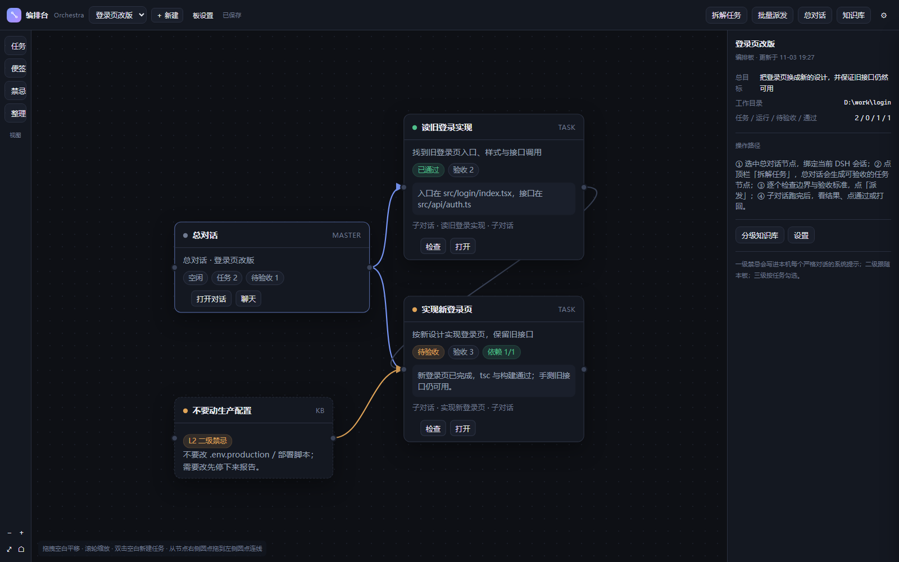

# 编排台（dsh-orchestra）

> ComfyUI 式的**连线工作台**：一个「总对话」把目标拆成可验收的子任务，派生**互相隔离**的子对话去执行；所有任务受一套**分级禁忌知识库**约束，一级最高、不可关闭。

- 侧栏入口：**编排台**
- 总对话：绑定你当前的 DSH 网页对话（桥接同一会话，不另开一套聊天）
- 子对话：每个任务新建一个**普通 DSH 会话**，只看得到自己的任务书
- 验收：子对话跑完停在「待验收」，你点通过或驳回打回；也可以先让总对话按验收标准复核
- 一级禁忌：写进本机每个会话的系统提示

> 仓库：<https://github.com/chen-rong1alkdwjlak/dsh->



---

## 它解决什么问题

长任务交给一个对话，常见三个问题：

1. **边界糊**：子任务顺手改别的文件，越做越大。
2. **验收虚**：说「做完了」，但没有证据，也没人逐条对标准。
3. **上下文串味**：子任务之间互相「听说」，责任和证据都追不回来。

编排台把这三件事做成结构：

- 每个任务节点必须写 **目标 / 边界 / 输入 / 交付物 / 验收标准**；
- 派发时把这些 + 分级禁忌 + 前置结果摘要拼成**一份自包含的任务书**；
- 子对话之间**没有任何消息通道**，跨任务信息只由总对话转交摘要；
- 跑完必须按 `<orchestra-result>` 协议回报：状态、摘要、产物、逐条自检。

---

## 安装（desktop profile）

先克隆仓库到任意目录（下面用 `<repo>` 代指该目录）：

```powershell
git clone https://github.com/chen-rong1alkdwjlak/dsh-.git <repo>
```

1. 在 `<DSH_HOME>\profiles\desktop\package.json` 的 `dependencies` 加（路径换成你的 `<repo>`）：

   ```json
   "dsh-orchestra": "link:C:/path/to/dsh-"
   ```

2. 在同一个文件的 `dsh.profile.bundles` 末尾加 `"dsh-orchestra"`。
3. 在 `<DSH_HOME>\profiles\desktop\node_modules\` 建一个目录联接：

   ```powershell
   New-Item -ItemType Junction -Path "$env:USERPROFILE\.dsh\profiles\desktop\node_modules\dsh-orchestra" -Target "C:\path\to\dsh-"
   ```

4. **重启一次 DeepSeek Harness**，侧栏就会出现「编排台」。

也可以用 CLI（会走 pnpm，仍需手动确认 bundles 列表）：

```powershell
& "<DeepSeek Harness 安装目录>\resources\runtime\cli\bin\dsh.cmd" plugin --profile desktop add link:C:/path/to/dsh-
```

> 插件要求 DSH `>= 0.2.1-rc.2`，因为用到了 `ctx.sessionController.create/prompt/inspect` 与 `session/event`。

---

## 五分钟上手

1. 打开侧栏 **编排台** → 新建编排板（填名称、总目标、工作目录）。
2. 选中 **总对话** 节点，点 **用当前对话作总对话**（或从下拉里「固定绑定选中会话」）。默认是**固定绑定**，切换网页对话不会把它带走；只有勾选 **跟随当前 DSH 对话** 才会自动改绑。
3. 点顶栏 **拆解任务**：总对话会输出一份 JSON 计划，插件把它变成任务节点，并按依赖自动排布。
4. 逐个点任务节点检查 **边界** 与 **验收标准**（这是插件存在的意义，别跳过）。
5. 点 **派发**：
   - 新建一个隔离子对话；
   - 把任务书作为第一条消息发进去；
   - 节点变成「子对话运行中」。
6. 子对话跑完 → 节点变「待验收」，右侧能看到结果、产物与逐条自检。
7. 需要的话点 **让总对话先复核**，总对话按验收标准给 PASS/FAIL 与证据缺口（只是建议）。
8. 你点 **通过**，或写清驳回要求点 **驳回并打回**（同一个子对话继续重做）。

依赖关系：任务 A → 任务 B 的连线表示 B 要等 A **通过** 才能派发；B 的任务书里会附上 A 的结果摘要（标注「由总对话转交」）。批量派发只派发当前可运行的那一批。

> **总对话本质是一条 DSH 会话，不是内嵌的 chat.deepseek.com 网页。** 默认它走 DSH 的模型路由（会消耗 API token）；想不花 API token，见下面「用网页版 DeepSeek」。

新增节点会自动在当前视野里找空位，不会叠在已有节点上，也不会移动镜头。如果之前的节点已经叠在一起，点左侧 **整理** 可以按依赖一次性排开（会覆盖手动位置，需确认）。

---

## 用网页版 DeepSeek（不花 API token）

总对话默认是一条 DSH 会话，planning/复核会走 DSH 当前的模型（通常是 API Key，消耗 token）。要让总对话改用 `chat.deepseek.com` 网页版的免费额度：

1. 安装网页登录 provider：
   ```
   dsh plugin --profile desktop add dsh-deepseek-web-login
   ```
2. 重启 DSH → **设置 → DeepSeek 网页登录** → 用浏览器登录网页版。
3. 打开编排台 → 选中 **总对话** → 右侧「总对话模型」点 **网页版 · 快速**（或「思考」）。

之后拆解/复核走网页额度，**不消耗 API token**。注意：

- 这是网页端私有接口的非官方客户端，有风控/限流风险，请自行判断。
- 同一账号同时只能跑一个网页模型请求，别同时开多个总对话/子对话。
- **子对话仍用各自模型**（它们通常要读写文件、跑工具）；想连子对话也走网页模型，需要另外配置。

---

## 删除与归档

- **删除节点**：鼠标移到任务/便签/禁忌节点的标题栏，右上角会出现 `×`；也可以选中节点后在右侧检查器底部点「删除节点」。删除只移除画布节点与连线，**不会删除 DSH 会话**。
- **删除编排板**：「板设置 → 删除编排板」。同样不会删除任何 DSH 会话。
- **归档已完成子任务**：默认在点「通过」时归档——子会话从 DSH 侧栏收起来，任务节点从画布活跃区消失；顶栏出现「已归档 N」，点一下可以重新显示（虚线、变淡）。
- **归档时机**：设置里可改成「子对话一跑完就归档」，不必等验收。
- 任务检查器里还有手动 **归档 / 取消归档**；归档失败（例如会话还在跑）会在提示里说明，任务仍保持通过状态。

---

## 知识库：四级禁忌

| 等级 | 名称 | 生效范围 |
|---|---|---|
| 1 | 一级禁忌 | **最硬**。总对话、每个子对话、本机每个严格对话的系统提示都会带上；不可关闭、内置条目不可删除 |
| 2 | 二级禁忌 | 当前编排板的所有任务 |
| 3 | 三级约束 | 按任务勾选，或从「禁忌节点」连线附加 |
| 4 | 参考资料 | 只在任务显式引用时附带，不算禁令 |

- 一级禁忌默认注入**所有会话**的系统提示，可在「设置」里关掉（不推荐）。
- 任务书里会再次完整列出适用的 1/2/3 级条目——即使系统提示被其他插件改写，任务书仍然带着禁令。
- 内置一级禁忌：不捏造、不擅自破坏、不泄露秘密、不绕过验收。可以改文本，不可删除。

数据都在：

```
<DSH_HOME>/orchestra/orchestra.json
```

会话正文不复制到这里，仍然只存在 DSH 会话日志里。

---

## 隔离与边界

**结构上**：

- 子对话是**普通 DSH 会话**，不是 subagent，没有给兄弟会话发消息的通道。
- 编排台从不把兄弟任务的任务书、对话或产物原样塞进另一个子对话；只转交**前置任务的结果摘要**。
- 子任务节点之间的连线只表示「顺序依赖」，不表示「可以通信」。
- 编排工具（`orchestra_board` / `orchestra_dispatch` / `orchestra_accept`）在子对话里调用会直接被拒绝。

**文本上**：每份任务书开头固定有隔离规则——只看到本任务书、缺信息写阻塞、不要联系其他子对话、结束只交一份结果报告。

**验收上**：子对话必须按协议输出：

```xml
<orchestra-result>
{"status":"done|blocked|failed","summary":"...","artifacts":["..."],"checks":[{"criterion":"...","pass":true,"evidence":"..."}]}
</orchestra-result>
```

解析失败时整段回答会当作摘要保留，节点仍停在「待验收」，不会自动通过。

---

## 给总对话用的工具

在**被绑定为总对话**的会话里，模型可以直接调用：

| 工具 | 作用 |
|---|---|
| `orchestra_board` | 看当前板的全部任务、状态、验收标准、依赖 |
| `orchestra_dispatch` | 派发一个任务（前置未通过时默认拒绝，`force` 可强推） |
| `orchestra_accept` | 通过或驳回一个待验收任务（驳回会把修改要求打回子对话） |

子对话调用会被拒绝，并返回「当前会话还没有绑定为任何编排板的总对话」。

如果你在设置里打开「子对话完成时通知总对话」，任务结束会把结果摘要作为一条用户消息发回总对话，唤醒它继续安排下一步——**是否通过仍然由你点**。

---

## 文件结构

```
index.js            宿主：REST API、会话桥、计划/派发/验收、工具、一级禁忌注入
client.js           浏览器：侧栏入口 + 主面板 iframe + 当前会话/打开会话桥
app/app.js          画布 UI（纯 DOM/SVG，无构建）
app/style.css       样式（跟随 DSH 明暗主题）
lib/store.js        单文件 JSON 存储、串行原子写
lib/kb.js           四级知识库、任务生效范围计算
lib/brief.js        计划/任务书/复核提示词与 JSON 解析
lib/boards.js       节点/连线规范化、计划落图、依赖与状态
lib/sessions.js     会话桥（create / prompt / inspect / 等待回合）
scripts/smoke.mjs   假 Host 端到端冒烟
scripts/ui-mock.mjs 假 API 的纯前端预览
test/core.test.mjs  纯逻辑单测
```

---

## 开发

```powershell
cd <repo>
node --test test/core.test.mjs    # 纯逻辑 13 项
node scripts/smoke.mjs            # 假 Host：建板→拆解→派发→收结果→复核→通过
node scripts/ui-mock.mjs 51234    # 打开 http://127.0.0.1:51234/orchestra/ 看画布
node scripts/cdp-check.mjs "http://127.0.0.1:<port>/?token=..." [shot.png]
                                  # 真机检查：侧栏入口、面板 iframe、未捕获异常
```

改了 `app/` 下的文件只需要刷新画布页面；改了 `index.js` / `lib/` 需要重启 DSH。

---

## 架构参考

这一版不是从零发明接线方式，主要参考/对照了 DSH 生态里已有的三类插件：

- **[dsh-synapse](https://www.npmjs.com/package/dsh-synapse)**：Host 用 `ctx.sessions.list()` + `session/event` 投影会话，浏览器侧用 `ctx.sessions` / `ctx.uiWorkspace` 打开会话，画布放在同源 iframe 里用 `postMessage` 桥接。本插件沿用同一套桥法，但把浮层换成了侧栏主面板。
- **Knotline（插件市场）**：把 Agent 工作流做成可连线画布的产品形态；本插件保留「节点 + 贝塞尔连线 + 检查器」的交互，但不引入 React Flow，改为无构建的 SVG，避免给 DSH 客户端增加打包依赖。
- **[dsh-deepseek-webdesk](https://github.com/zneoxlab/dsh-deepseek-webdesk)**：用 Electron webview 把 chat.deepseek.com 搬进侧栏。按你的选择，本插件的「总对话」接的是**当前 DSH 网页对话**，不是内嵌的 DeepSeek 官网页面，所以不需要网页登录态与 DOM 抓取。

会话侧只用了 Host 的公开面：`ctx.sessionController.create / prompt / inspect`、`ctx.sessions.get/list`、`ctx.on('session/event')`。子对话因此是**普通 Session**，不是 subagent，天然没有兄弟消息通道。

---

## 已知限制

- **计划质量取决于总对话**：它会输出 3–7 个任务；解析失败会明确报错，不会静默生成节点。
- **子对话是一次性普通会话**：驳回会复用同一个子会话继续；「重新派发」会新开一个，旧会话仍留在 DSH 侧栏。
- **等待回合有超时**：拆解/复核默认等 4 分钟；超时按失败处理，可重试。
- **通知总对话会消耗一次模型回合**：默认关闭，可在设置里打开。
- **单机单进程假设**：同一份 `orchestra.json` 被两个 DSH 进程同时写时是「后写覆盖」；不要同时跑两个共用 profile 的实例。
- **画布只存编排元数据**：删除节点不会删除 DSH 会话；归档会话请在 DSH 侧栏操作。

---

MIT.
